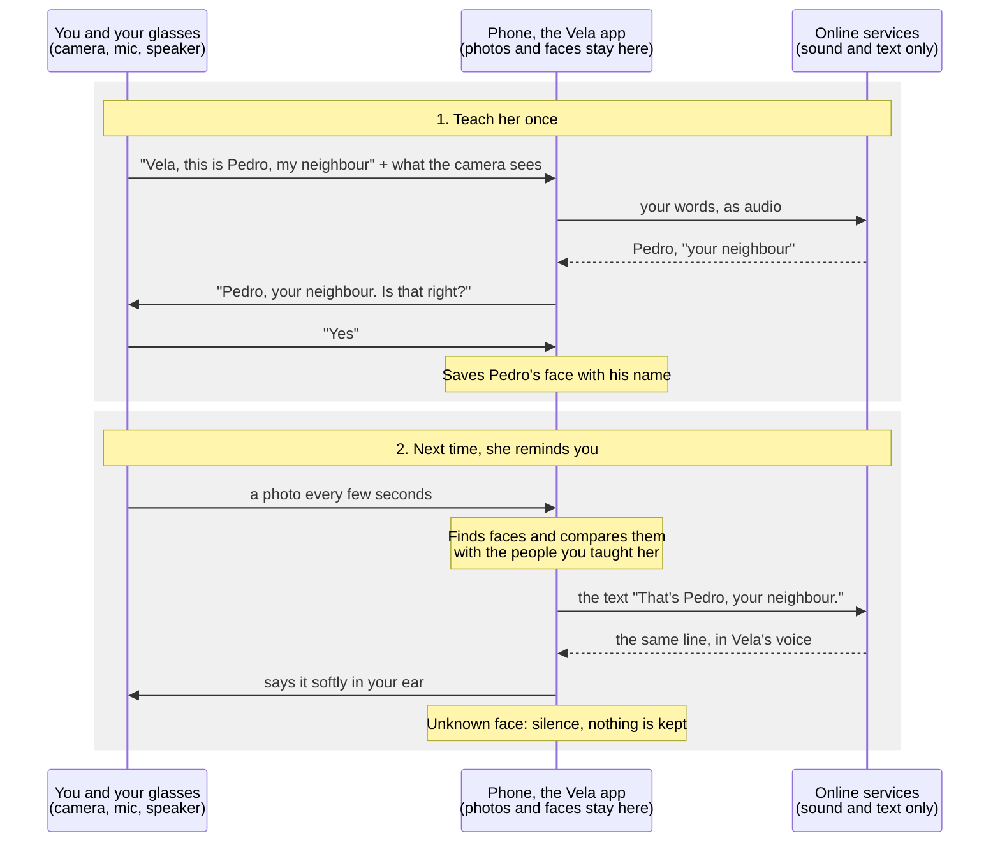

# Architecture



| In the diagram | In the code |
|---|---|
| Finds and compares faces | `faces.js`: Human (BlazeFace + FaceRes) on WebGL, in the phone's browser engine |
| Your words, as audio | mic, voice-activity segmenter, `/api/stt` (Groq Whisper) |
| Name and relation | `/api/understand` (Groq gpt-oss-20b) |
| Vela's voice | `voice/el/*.mp3` on an exact text match, else `/api/tts` (ElevenLabs, cached) |
| Camera, mic, speaker | `VelaDevice`: Ray-Ban Meta glasses through the Android shell, or the phone itself |

The Vela server sits between the phone and the online services: it relays those three calls and holds the keys.

| Folder | What |
|---|---|
| `app/public/` | PWA: vanilla ES modules, no build |
| `app/server/` | Node 22, no runtime deps: static files, `/api/stt`, `/api/understand`, `/api/tts`, `/api/config`, `POST /log` |
| `android/` | Kotlin shell: WebView, Meta DAT session, phone fallback, foreground service |
| `eval/` | [face matching test](../eval/README.md) |
| `landing/` | static site, meetvela.tech |

## Server
- Every `/api/*` and `/log` call needs `x-vela-token` (`APP_TOKEN`).
- Voice: ElevenLabs Flash, voice "Lily" (`server/voice.json`). Fixed lines in `public/voice/el/manifest.json` play on an exact text match; any other line is generated once and cached on disk. Kokoro only if ElevenLabs fails.
- Speech: Groq `whisper-large-v3-turbo`; hallucinations ("Thank you.") and very quiet takes are dropped.

## VelaDevice
```ts
interface VelaDevice {
  start(): Promise<void>; stop(): Promise<void>;
  getFrame(): Promise<Blob>;                          // one JPEG still
  audio(): MediaStream | AsyncIterable<Int16Array>;   // mono mic
  say(audio: Blob | string): Promise<void>;           // one short line
  state: 'idle'|'connecting'|'ready'|'error'; onStateChange(cb): void;
}
```
`PhoneDevice` (rear camera) and `GlassesDevice` (over `window.VelaNative`, picked by `?device=glasses`).

## The glasses bridge
`window.VelaNative` is injected into the app's origin only. Every call returns a Promise.

| Call | Result |
|---|---|
| `captureFrame({maxEdge, maxAgeMs})` | sharpest recent JPEG (base64) + size, source, timing |
| `glasses()` / `connectGlasses()` | `{status, action, message}` and the one button |
| `connect()` / `disconnect()` / `state()` / `onState(cb)` | session control |
| `setSource('auto'\|'glasses'\|'phone')` | auto = glasses when ready, else phone |
| `backgroundMode()` / `onTick(cb)` | foreground service on; native 1 s heartbeat |
| `audioRoute()` / `setMicRoute()` | where sound goes; mic on glasses or phone |
| `openMetaAi('app'\|'settings'\|'store')` | opens Meta AI |
| `useMock({enabled})` | Meta's Mock Device Kit |

Mic in the shell: `echoCancellation:false, noiseSuppression:true, autoGainControl:true`, which keeps Android out of call mode.

## Shell code (`android/app/src/main/java/app/vela/shell/`)
`GlassesSource.kt` session, capture, recovery · `LiveFrames.kt` YUV to JPEG, sharpness · `PhoneCameraSource.kt` fallback · `FrameHub.kt`, `SourcePolicy.kt` which camera serves a frame · `MainActivity.kt` WebView, bridge · `WatchService.kt` foreground service · `AudioRouter.kt` Bluetooth routing · `MetaAi.kt` Meta AI detection.

[Toolkit notes](research/meta-dat.md)
